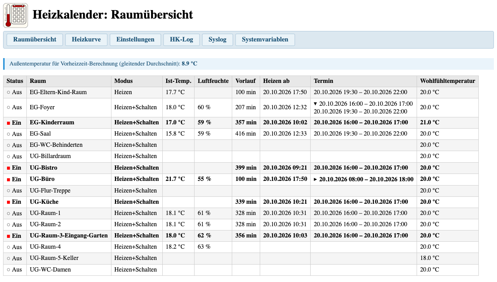
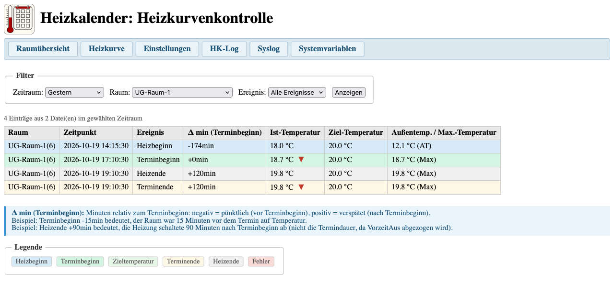
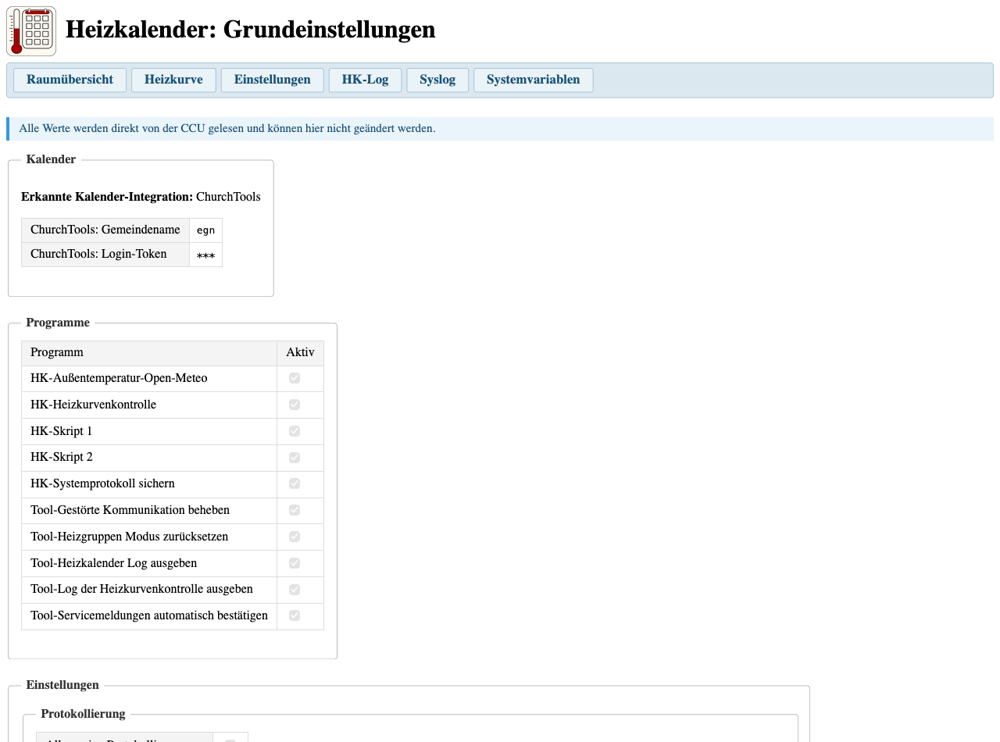
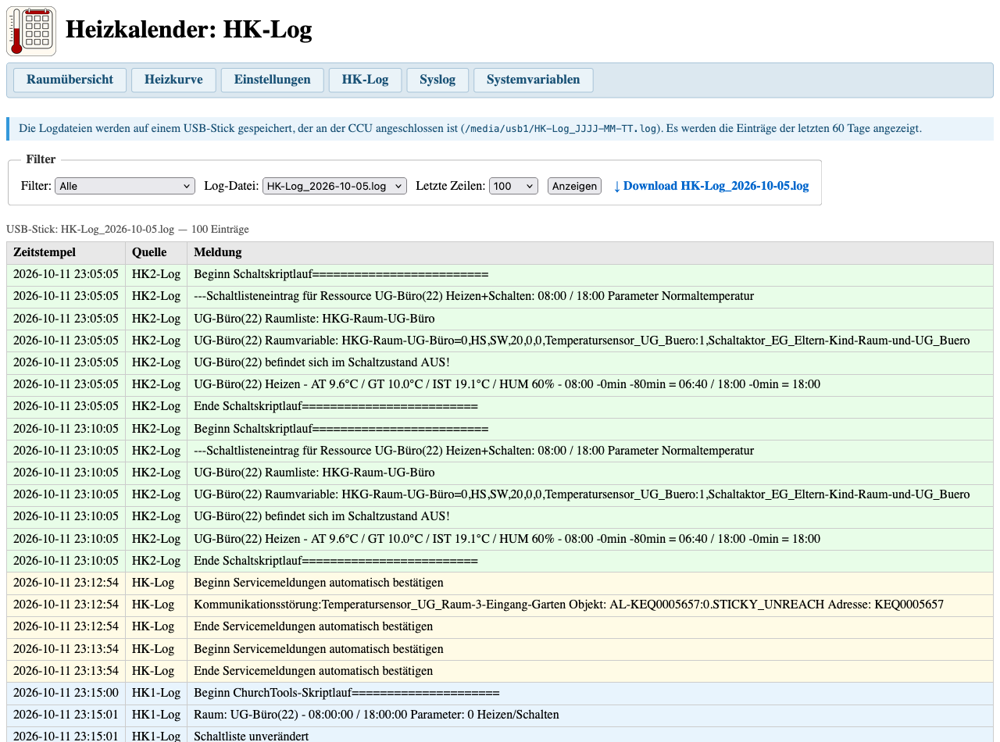
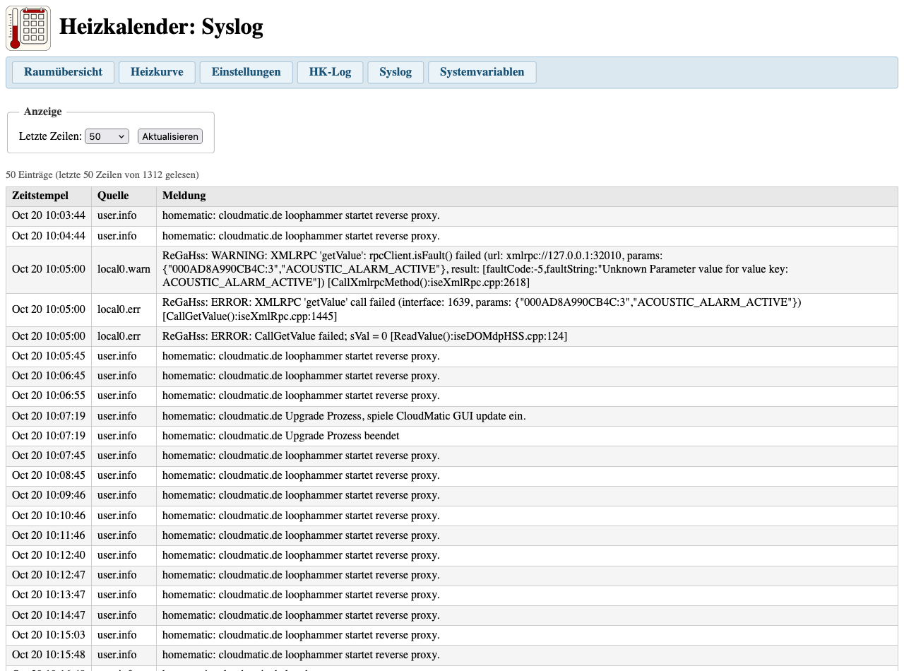
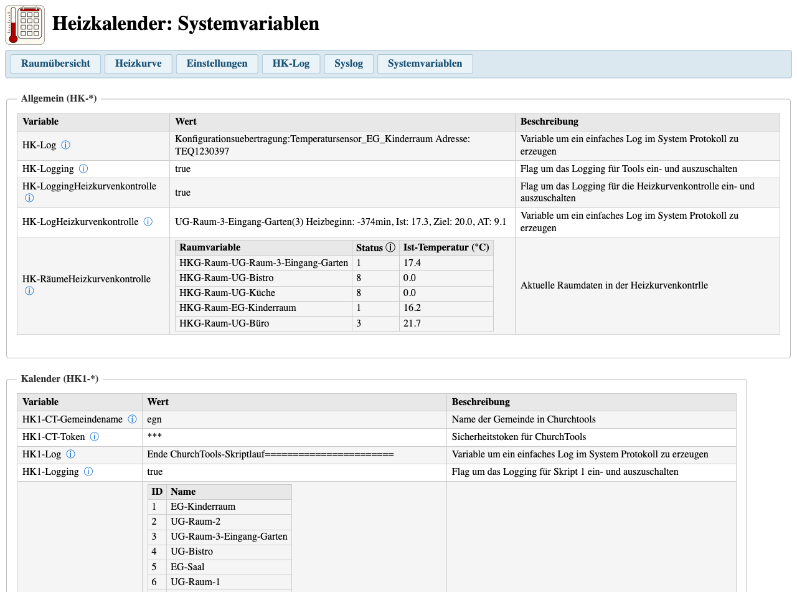

# Heizkalender Addon: Anwenderhandbuch

## Überblick

Das Heizkalender Addon stellt eine Weboberfläche auf der CCU bereit, über die der laufende Betrieb des Heizkalenders beobachtet werden kann. Die Oberfläche ist über den Browser erreichbar und erfordert keine zusätzliche Software.

Die Oberfläche ist grundlegend responsiv gestaltet (Navigation bricht um, Tabellen scrollen horizontal). Eine vollständige Optimierung für Mobilgeräte ist jedoch nicht möglich, da die Tabellen mit ihren vielen Spalten auch auf kleinen Displays eine gewisse Mindestbreite benötigen.

Die Startseite des Addons ist über die CCU-Weboberfläche unter **Einstellungen > Zusatzsoftware > Heizkalender > Einstellungen** erreichbar, oder direkt unter:

```link
http://<IP-der-CCU>/addons/heizkalender/
```

---

## Voraussetzungen

- HomeMatic CCU3 oder RaspberryMatic
- Heizkalender-Skripte (Skript 1 und Skript 2) eingerichtet und aktiv
- Für HK-Log und Heizkurvenkontrolle: USB-Stick an der CCU angeschlossen, auf dem die Logdateien gespeichert werden (`HK-SystemProtokoll sichern.hsc` muss als Programm eingerichtet sein)

---

## Installation

Das Addon wird über die CCU-Weboberfläche installiert:

1. Unter **Einstellungen > Zusatzsoftware** auf **Installieren** klicken.
2. Die Datei `heizkalender-addon.tar.gz` auswählen und hochladen.
3. Die CCU startet nach der Installation neu.

Nach dem Neustart erscheint der Heizkalender in der Liste der installierten Zusatzsoftware.

---

## Raumübersicht

**Erreichbar unter:** `/addons/heizkalender/index.cgi`

Die Raumübersicht zeigt für jeden konfigurierten Raum den aktuellen Heizstatus auf einen Blick.



| Spalte | Bedeutung |
| ------ | --------- |
| Status | `EIN` wenn der Raum gerade heizt, `AUS` wenn nicht |
| Raum | Name des Raums (aus der Raum-Systemvariablen `HKG-Raum-*`) |
| Modus | Heizmodus: Heizen, Schalten oder Heizen+Schalten |
| Ist-Temp. | Aktuelle Raumtemperatur (wenn ein Sensor zugeordnet ist) |
| Luftfeuchte | Aktuelle Luftfeuchtigkeit (wenn der Sensor diesen Wert liefert) |
| Vorlauf | Berechnete Vorheizzeit in Minuten (nur wenn `HK2-Schaltzeiten` vorhanden) |
| Heizen ab | Berechneter Einschaltzeitpunkt (nur wenn `HK2-Schaltzeiten` vorhanden) |
| Termin | Beginn und Ende des nächsten oder laufenden Termins aus der Schaltliste; bei mehreren Terminen aufklappbar |
| Wohlfühltemperatur | Zieltemperatur für den Raum |

Die Spalten **Vorlauf** und **Heizen ab** werden nur angezeigt, wenn die Systemvariable `HK2-Schaltzeiten` auf der CCU vorhanden ist. Ist sie nicht angelegt, entfallen diese beiden Spalten.

**Statusermittlung:** Der Status wird direkt aus Feld 0 der jeweiligen `HKG-Raum-*`-Systemvariablen gelesen (0 = `AUS`, 1 = `EIN`). Die Spalte „Termin" zeigen die Zeiten aus der Schaltliste (`HK1-Schaltliste`).

Ganz oben wird, falls vorhanden, die aktuelle Außentemperatur (gleitender Mittelwert) angezeigt, die für die Vorheizzeitberechnung verwendet wird.

**Mehrere Termine pro Raum und Tag:** Hat ein Raum an einem Tag mehr als einen Termin in der Schaltliste, wird in der Terminspalte zunächst nur der erste Eintrag angezeigt. Durch Klick auf diesen Eintrag klappt die Zelle auf und zeigt alle weiteren Termine des Raums.

**Raum-Gruppen:** Ein Raum kann über `HK2-HKG-Liste` als Teil einer Gruppe konfiguriert sein, d.h. er wird bei der Buchung anderer Ressourcen mitgeheizt. In diesem Fall sammelt das Addon alle Ressourcen-IDs, für die der Raum zuständig ist (eigene Ressource und alle Gruppen, in denen er Mitglied ist), und zeigt sämtliche zugehörigen Termine in einer einzigen Zeile an. Der Raum erscheint also immer nur einmal in der Tabelle, egal wie viele Ressourcen ihn einschließen.

**Hinweis:** Die Seite zeigt ausschließlich Heizdaten. Der ursprüngliche Terminname aus dem Kalender ist in der Schaltliste nicht enthalten.

---

## Heizkurvenkontrolle

**Erreichbar unter:** `/addons/heizkalender/hkkurve.cgi`

Die Heizkurvenkontrolle wertet die aufgezeichneten Heizereignisse aus dem USB-Stick-Archiv aus und zeigt, wie gut die Heizung die gewünschte Temperatur zum Terminbeginn erreicht hat.



> [!NOTE]
> **Voraussetzung:** USB-Stick mit HK-Log-Dateien (siehe [HK-Log](#hk-log)).
> Da `HK-SystemProtokoll sichern.hsc` alle 29 Minuten läuft, kann die Anzeige bis zu 29 Minuten hinter dem aktuellen Geschehen zurückliegen.

**Filter:**

| Filter | Bedeutung |
| ------ | --------- |
| Zeitraum | Heute (Standard), Gestern, letzte 7 Tage, letzte 30 Tage oder letzte 90 Tage |
| Raum | Alle Räume oder ein bestimmter Raum (inkl. Gruppenräume) |
| Ereignis | Alle Ereignisse (Standard) oder ein bestimmter Typ |

Nach Auswahl der Filter auf **Anzeigen** klicken. Die Seite lädt erst dann Daten.

**Ereignistypen:**

Die Tabelle zeigt die Ereignisse Heizbeginn, Terminbeginn, Zieltemperatur, Terminende, Heizende und Fehler. Die Zeilen haben einen alternierenden Hintergrund (grau/weiß).

Die Spalte **Δ min** gibt an, wie viele Minuten vor (negativ) oder nach (positiv) dem Terminbeginn das Ereignis eingetreten ist.

**Einfärbung der Zieltemperatur-Ereignisse:**

Zeilen vom Typ *Zieltemperatur* werden anhand der Vorlaufzeit (Δ min) farblich bewertet:

| Farbe | Bewertung | Δ min (Standard) | Bedeutung |
| ----- | --------- | ----------------- | --------- |
| Grün | Perfekt | −20…+5 min | Zieltemperatur rechtzeitig erreicht |
| Gelb | Akzeptabel | −45…−20 oder +5…+15 min | Etwas zu früh oder zu spät |
| Rot | Kritisch | < −45 oder > +15 min | Deutlich zu früh (Energieverschwendung) oder zu spät |

Die Schwellwerte lassen sich über die optionale Systemvariable `HK2-HKK-Zieltemperatur` anpassen. Format: vier Semikolon-getrennte Werte `Kritisch-vor;Perfekt-von;Perfekt-bis;Kritisch-nach`, z.B. `-90;-60;-30;-15`. Ohne die Variable gelten die oben gezeigten Standardwerte.

**Beispiel mit angepassten Schwellwerten** (`-90;-60;-30;-15`):

| Farbe | Bewertung | Δ min | Bedeutung |
| ----- | --------- | ----- | --------- |
| Grün | Perfekt | −60…−30 min | Zieltemperatur 60 bis 30 min vor Termin erreicht |
| Gelb | Akzeptabel | −90…−60 oder −30…−15 min | Bis 30 min zu früh oder bis 15 min vor Termin |
| Rot | Kritisch | < −90 oder > −15 min | Alles andere |

**Indikatoren in der Spalte „Ist-Temp.":**

In den Zeilen *Terminbeginn* und *Terminende* erscheint neben der Temperatur ein farbiges Symbol:

| Symbol | Farbe | Bedeutung |
| ------ | ----- | --------- |
| ▲ | Grün | Ist-Temperatur hat die Zieltemperatur erreicht |
| ▼ | Rot | Ist-Temperatur lag noch unter der Zieltemperatur |

---

## Grundeinstellungen

**Erreichbar unter:** `/addons/heizkalender/hkconfig.cgi`

Die Seite zeigt die wichtigsten Einstellungen des Heizkalenders in aufbereiteter Form: Logging-Flags, Kurveneinstellungen und eine Übersicht aller Raumkonfigurationen. Die Abschnitte entsprechen 1:1 den Seiten des Windows-Installers und dienen als Nachschlagewerk, wenn man gerade nicht am passenden PC sitzt oder remote auf die CCU zugreift. Die Seite ist rein lesend. Änderungen werden über den Installer vorgenommen.



---

## HK-Log

**Erreichbar unter:** `/addons/heizkalender/hklog.cgi`

Das HK-Log zeigt die auf dem USB-Stick archivierten Protokolleinträge des Heizkalenders. Die Einträge werden aus den tages- oder wochenweisen Logdateien gelesen, die `HK-SystemProtokoll sichern.hsc` auf den USB-Stick schreibt.



> [!NOTE]
> **Voraussetzung:** USB-Stick an der CCU angeschlossen, Logdateien vorhanden (`HK-Log_JJJJ-MM-TT.log`). Es werden Dateien der letzten 60 Tage angezeigt.
> Da `HK-SystemProtokoll sichern.hsc` alle 29 Minuten läuft, kann die Anzeige bis zu 29 Minuten hinter dem aktuellen Geschehen zurückliegen.

**Zeitstempel-Format:** `JJJJ-MM-TT HH:MM:SS` (aus der CCU-Historiendatenbank).

**Filter:**

| Filter | Bedeutung |
| ------ | --------- |
| Filter | Alle Einträge oder nur eine Quelle (HK1, HK2, Heizkurvenkontrolle, HK-Log, Nachtabschaltung) |
| Log-Datei | Auswahl der Tagesdatei |
| Letzte Zeilen | Anzahl der angezeigten Zeilen (Standard: 50, max. 5000) |

Die Anzeige entspricht einem `tail`: die letzten N Zeilen der Datei, älteste oben, neueste unten.

Über den **Download**-Link kann die gewählte Logdatei heruntergeladen werden.

---

## Syslog

**Erreichbar unter:** `/addons/heizkalender/syslog.cgi`

Das Syslog zeigt die letzten Einträge aus dem Linux-Systemprotokoll der CCU (`/var/log/messages`).



**Zeitstempel-Format:** `Mmm DD HH:MM:SS` (Linux-Syslog-Format, ohne Jahreszahl).

| Einstellung | Bedeutung |
| ----------- | --------- |
| Letzte Zeilen | Anzahl der angezeigten Zeilen (Standard: 50, max. 2000) |

Die Anzeige entspricht einem `tail`: älteste Zeilen oben, neueste unten.

---

## Systemvariablen

**Erreichbar unter:** `/addons/heizkalender/sysvars.cgi`

Die Seite zeigt alle Systemvariablen des Heizkalenders mit ihrem aktuellen Wert und einer kurzen Beschreibung. Die Variablen sind nach Präfix gruppiert:



| Abschnitt | Präfix | Inhalt |
| --------- | ------ | ------ |
| Allgemein | `HK-*` | Logging-Flags und Log-Variablen |
| Kalender | `HK1-*` | Variablen für Skript 1 (Termineinlesen) |
| Schalten | `HK2-*` | Variablen für Skript 2 (Schalten und Heizen) |
| Räume | `HKG-Raum-*` | Individuelle Raumkonfigurationen |

Die Seite ist rein lesend. Werte können nur direkt in der CCU-Weboberfläche geändert werden.
