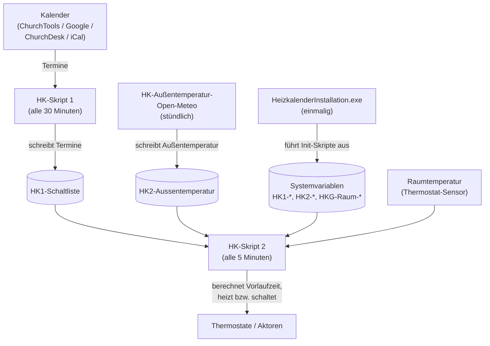
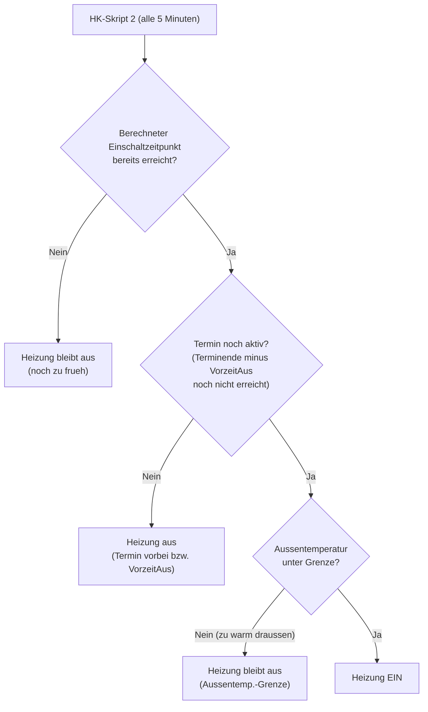
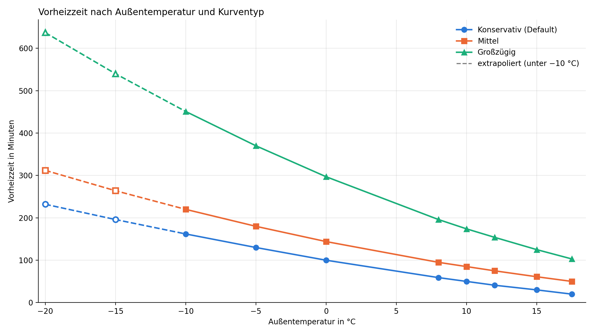
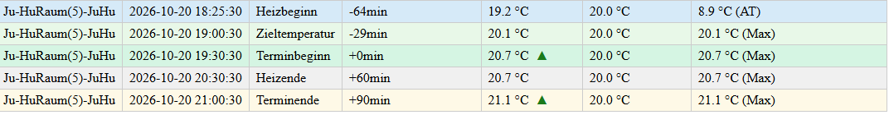

# Anwenderhandbuch

Der Heizkalender hilft, Energie und Kosten zu sparen, ohne auf Komfort verzichten zu müssen. Er wurde speziell für Gebäude entwickelt, deren Räume nur sporadisch oder unregelmäßig genutzt werden – beispielsweise Gemeindegebäude, Vereinsheime, Büros, Freizeitheime, Jugendherbergen oder Ferienwohnungen.

Die Steuerung erfolgt automatisch über externe Kalender, etwa Belegungs- oder Veranstaltungskalender. Sobald ein Raum gebucht ist, plant der Heizkalender anhand der Wettervorhersage, der aktuellen Raumtemperatur und der individuellen Vorheizzeit den optimalen Heizbeginn. So ist der Raum zum Nutzungstermin möglichst angenehm warm, ohne unnötig lange vorher beheizt zu werden. Nicht genutzte Räume bleiben auf einer energiesparenden Grundtemperatur.

Auch andere Geräte wie Außenbeleuchtungen oder Lüftungsanlagen lassen sich kalendergesteuert schalten. Über Systemvariablen können zudem eigene Skripte und komplexere Automatisierungen ausgelöst werden.

Das Ergebnis: weniger Energieverbrauch, geringerer Steuerungsaufwand und komfortabel vorbereitete Räume – ganz automatisch und abgestimmt auf die tatsächliche Nutzung.

Dieses Handbuch richtet sich an Administratoren, die den Heizkalender betreiben und
konfigurieren. Es erklärt die wiederkehrenden Aufgaben im laufenden Betrieb: Räume
benennen, das Heizverhalten über die Vorheizzeit einstellen und einzelne Termine mit
Sonderbefehlen steuern.

Durch die gesamte Installation führen folgende Dokumente:

- [Struktur planen](planung.md)
- [Zugangsdaten für Kalender beschaffen](kalender-einrichten.md)
- [Einrichtung der CCU](ccu-einrichten.md)
- [Einrichtung des Heizkalenders mir der `HeizkalenderInstallation.exe`-Anleitung](../heizkalender-installation/readme.md).

> [!WARNING]
> **In dieser Beschreibung werden Systemvariablen direkt mir Ihrem Namen benannt. Wenn der `HeizkalenderInstallation.exe` verwendet wird, kann dieses Programm für die Einstellung aller hier beschrieben Parameter verwendet werden!**
>
> **Systemvariablen sollten nicht mit der Hand, oder anderen Tools verändert werden, außer man ist sicher über die Auswirkungen im klaren.**

Die vollständige Liste aller Systemvariablen findet sich in der
[Skript-Referenz](../skripte/readme.md).
Einen allgemeinen Überblick über das Projekt und weitere Varianten bietet auch die
Projekt-Homepage <https://heizkalender.de/>.

## Warum Homematic?

Homematic ist derzeit das einzige Smart-Home-System, für das der Heizkalender
implementiert wurde. Andere Systeme wären grundsätzlich denkbar, sobald sich
Entwickler finden, die entsprechende Skripte erstellen.

Gründe für die Wahl von Homematic:

1. **Skripte direkt auf der CCU:** Gegenüber anderen Systemen hat Homematic den
   großen Vorteil, dass man ohne zusätzliche Hilfsprogramme (IO-Broker, Home
   Assistant) Skripte direkt auf der Zentrale laufen lassen kann. Die Software
   der CCU3 ist weitgehend offen.

2. **Bidirektionale Kommunikation:** Das System meldet zurück, ob ein Aktor
   erfolgreich geschaltet wurde. Das ist in der Software direkt sichtbar.

3. **Stabil und qualitativ hochwertig:** Für den Heizkalender genügt eine CCU3
   oder ein Raspberry Pi, beide sind preisgünstig.

4. **Geräte untereinander verknüpft:** Die Geräte sind neben der Verknüpfung mit
   der Zentrale (CCU) auch untereinander direkt verknüpft, so dass sie bei Ausfall
   der Zentrale trotzdem noch funktionieren.

5. **Offene Programmierschnittstelle:** Das System ermöglicht das Schreiben eigener
   Programme. Das ist die Grundvoraussetzung für den Heizkalender.

6. **Weit verbreitet:** Homematic ist ein verbreitetes System mit entsprechender
   Marktpräsenz und Langzeitverfügbarkeit.

7. **Große Community:** Eine aktive Community im Internet bietet Hilfen, Tipps und
   beantwortet Fragen.

**Hinweis:** Homematic ist ein deutsches System der Firmengruppe eQ-3/ELV und leider
teurer als ZigBee und ähnliche Systeme. Das Heizkalender-Team ist offen für andere
Smarthome-Systeme und würde eine Verknüpfung unterstützen. Eine eigene Initiative dazu
ist jedoch nicht möglich.


## Wie/Was kann der Heizkalender steuern?

Der Heizkalender wurde ursprünglich für die zeitgesteuerte Steuerung von Heizungen entwickelt. Darüber hinaus lassen sich mit ihm auch beliebige andere Schaltaktoren ansteuern. In Verbindung mit eigenen Skripten können zudem komplexere Steuerungsaufgaben umgesetzt werden.

Dafür stehen vier Betriebsmodi zur Verfügung:

- **Heizen**  
  Dies ist der Standardmodus für die Beheizung von Räumen. Anhand der Außentemperatur, der aktuellen Raumtemperatur, der individuellen Vorheizzeiten und der eingestellten Heizkurve berechnet der Heizkalender, wann mit dem Heizen begonnen werden muss, damit die gewünschte Wohlfühltemperatur zu den Nutzungszeiten erreicht wird.

  Außerhalb der Nutzungszeiten wird die Temperatur auf eine individuell einstellbare Grundtemperatur abgesenkt.

  Typische Anwendungsfälle sind die Steuerung von Heizgruppen oder Thermostaten.

- **Heizen und Schalten**  
  Dieser Modus dient ebenfalls der zeitgesteuerten Beheizung von Räumen. Wie im Modus *Heizen* berücksichtigt der Heizkalender die Außentemperatur, die aktuelle Raumtemperatur, die individuellen Vorheizzeiten und die eingestellte Heizkurve, um die gewünschte Wohlfühltemperatur zu den Nutzungszeiten zu erreichen.

  Der Unterschied zum Modus *Heizen* liegt in der Art der Heizungssteuerung: Ein Thermostat dient ausschließlich zur Erfassung der aktuellen Raumtemperatur. Das Ein- und Ausschalten der Heizung erfolgt über separate Schaltaktoren.

  Voraussetzung ist, dass die Heizung selbst über eine eigene Temperaturregelung verfügt. Dieser Modus eignet sich beispielsweise für Lüftungsheizungen.

  Typische Komponenten sind Thermostate zur Temperaturmessung und Schaltaktoren zur Steuerung der Heizung.

- **Schalten**  
  Dieser Modus dient zum zeitgesteuerten Ein- und Ausschalten beliebiger Geräte. Für jedes Gerät lassen sich individuelle Vor- und Nachlaufzeiten festlegen. Dadurch können Geräte bereits vor Beginn einer Nutzung eingeschaltet und nach deren Ende wieder ausgeschaltet werden.

  Während der vorgesehenen Nutzungszeit bleibt das Gerät eingeschaltet. Außerhalb der Nutzungszeit wird es ausgeschaltet. Die Schaltzeiten sind unabhängig von der Temperatur.

  Typische Anwendungsfälle sind die Steuerung von Außenbeleuchtungen oder Belüftungsanlagen. Angesteuert werden in der Regel Schaltaktoren.

- **Variable setzen**  
  Dieser Modus ähnelt dem Modus *Schalten*, steuert jedoch keine Geräte direkt, sondern eine interne Systemvariable. Auch hier können individuelle Vor- und Nachlaufzeiten festgelegt werden.

  Beim Einschalten wird die Systemvariable auf `true`, beim Ausschalten auf `false` gesetzt. Eigene Skripte können den Wert dieser Variable auswerten und daraufhin weitere komplexe Aktionen ausführen.

  Dieser Modus eignet sich insbesondere für komplexere Steuerungsaufgaben, die sich nicht unmittelbar mit einem der drei anderen Modi abbilden lassen. Auf diese Weise kann der Heizkalender als zeitgesteuerter Auslöser für individuelle Automatisierungen dienen.


## Wie der Heizkalender funktioniert

Der Heizkalender hält Räume grundsätzlich auf einer niedrigen Grundtemperatur und
schaltet nur dann auf Wohlfühltemperatur, wenn im Kalender ein Termin eingetragen ist.
Dadurch lassen sich 15 bis 25 Prozent Heizenergie sparen, ohne dass jemand vor Ort
die Heizung manuell bedienen muss.

Aus Praxis-Messungen ergibt sich ein konkretes Einsparpotential: Bei einem Gebäude,
das 1,5 von 7 Tagen auf voller Wohlfühltemperatur (21 °C) beheizt wird und sonst auf
Grundtemperatur (16,5 °C) läuft, ergibt sich rund 25 Prozent weniger Energieverbrauch
gegenüber Dauerbetrieb.

Der Ablauf im Überblick:



Ablauf im Detail:

1. **Einmalig:** Die `HeizkalenderInstallation.exe` erzeugt über die Init-Skripte die Systemvariablen.
2. **Stündlich:** `HK-Außentemperatur-Open-Meteo` aktualisiert die Außentemperatur in `HK2-Aussentemperatur`.
3. **Alle 30 Minuten:** Skript 1 liest den Kalender und schreibt die anstehenden Termine in `HK1-Schaltliste`.
4. **Alle 5 Minuten:** Skript 2 berechnet aus der Schaltliste, der Außentemperatur und der aktuellen Raumtemperatur die Vorlaufzeiten und heizt bzw. schaltet die Räume entsprechend.

## Voraussetzungen

### Kalender

Die Gebäudenutzung (Raumbelegung) muss möglichst konsequent über ein Kalendertool
gepflegt werden. Der Heizkalender unterstützt zwei technische Zugangsarten:

- **Application Programming Interface (API):** Programmierspezifischer Zugang, bietet
  mehr Möglichkeiten und ist die bevorzugte Variante (ChurchTools, Google).
- **Internet Calendar Scheduling (ICS/iCal):** Allgemeiner Kalenderstandard, universell
  verwendbar, aber im Funktionsumfang eingeschränkter (ChurchDesk, beliebige iCal-URLs).

Unterstützte Kalenderquellen:

- ChurchTools (via API)
- Google-Kalender (via API)
- ChurchDesk (mit spezieller ICS-Version)
- ChurchDesk (mit API Zugriff)
- Sonstige ICS/iCal-kompatible Kalender (mit allgemeiner ICS-Version)

### Homematic-Hardware

Alle Heizkörper der zu steuernden Räume müssen mit Homematic-Thermostaten ausgestattet
sein. Der Heizkalender unterstützt sowohl die Klassik-Serie (auslaufend) als auch die
IP-Serie (aktuell, empfohlen). Innerhalb einer zu schaltenden Gruppe müssen alle Geräte
derselben Serie angehören. Die Thermostatventile kosten ab ca. 25 Euro pro Stück.

Nebenräume (Flure, WCs), die dauerhaft auf Grundtemperatur bleiben sollen, benötigen
keinen steuerbaren Thermostat. Eine Grundtemperatur von 16 °C entspricht dem
Skalenwert 2 (Schneeflocken-Symbol) an üblichen Thermostatventilen.

### Central Control Unit (CCU)

Für die Installation der Heizkalender-Skripte und die Steuerung der Ventile wird
eine kompatible Smart-Home-Zentrale benötigt, die Internetverbindung für den
Kalender-Abruf hat. Empfohlen wird [OpenCCU](https://github.com/jens-maus/RaspberryMatic)
(bis Ende 2025 als „RaspberryMatic" bekannt): ein freies, OpenSource-Betriebssystem
für Homematic-CCU-Zentralen. Die Hersteller-Software der CCU3 von eQ-3 ist
abgekündigt; eQ-3 übergibt die Weiterentwicklung schrittweise an die Community
(bis Ende 2026 werden noch neue Homematic-IP-Produkte integriert, ab 2027 übernimmt
die Community). Hintergründe dazu sind auf der
[eQ-3-Informationsseite](https://homematic-ip.com/de/news/ccu3-smart-home-naechstes-kapitel)
nachzulesen. Es läuft auf eQ3-CCU3, ELV-Charly, RaspberryPi,
Tinkerboard, ODROID und zahlreichen weiteren Plattformen einschließlich
virtueller Maschinen (Proxmox, Docker, Home Assistant u.a.).

Kosten: ca. 80 Euro (Raspberry Pi mit einfachem Funkmodul) bis ca. 180 Euro
(CCU2 der Firma ELV mit erweiterten Smart-Home-Funktionen).

### Apps (optional)

Der Heizkalender kann vollständig ohne Apps eingerichtet und betrieben werden. Als
ergänzende Bedienoberfläche für die CCU sind folgende Apps geeignet:

- **Mediola:** vielfältig, Grundrisse möglich, aber aufwändig
- **@Home:** gut bei Grafiken, kostenlos mit Werbung
- **pocket control HM** (nur iPhone): gut im Verwalten, sehr geringe Kosten
- **TinyMatic** (nur Android): zum Erstellen von Systemvariablen kostenlos nutzbar

## Installation, Updates und Konfiguration mit der `HeizkalenderInstallation.exe`

Die `HeizkalenderInstallation.exe` ist das zentrale Werkzeug für die Installation und Verwaltung des Heizkalenders. Mit ihr lassen sich alle erforderlichen Skripte und Systemvariablen auf der CCU einrichten sowie die Verbindung zum verwendeten Kalendersystem konfigurieren.

Auch spätere Änderungen an der Konfiguration können bequem über das Programm vorgenommen werden. Stehen Updates zur Verfügung, unterstützt die Anwendung zudem die Aktualisierung des Heizkalenders.

**Die Bedienung ist bewusst einfach gehalten:** Im Normalfall sind nur wenige manuelle Schritte über die Web-Oberfläche der CCU und deren Bordmittel erforderlich. Dadurch können auch technisch interessierte Anwender ohne tiefgehende Homematic-Kenntnisse die Installation, Konfiguration und Aktualisierung selbst durchführen.

## Namenskonvention

Innerhalb der CCU dürfen **keine Namen doppelt auftreten**. Das gilt für Kanäle,
Geräte, Räume und Systemvariablen gleichermaßen. Doppelte Namen führen dazu, dass
die Skripte das falsche oder gar kein Objekt ansprechen.

Besondere Sorgfalt braucht die Raumbezeichnung im Kalender:

- **ChurchTools und ChurchDesk:** Der Administrator legt „Ressourcen" an, aus denen
  der Benutzer beim Eintragen eines Termins auswählt. Dadurch ist die Bezeichnung
  automatisch eindeutig. Wird keine Ressource ausgewählt, wird der Raum nicht beheizt.
- **Google-Kalender und ICS/iCal:** Hier muss der Raum mit einer eindeutigen, stets
  gleichen Bezeichnung (mit vorangestelltem `#`) im Termintitel eingetragen werden.
  Wählen Sie schon bei der Installation unverwechselbare Bezeichnungen und verwenden
  Sie bei jedem Termin genau diese fehlerfrei. Umgekehrt darf die Bezeichnung nicht
  auftauchen, wenn der Raum nicht gemeint ist.

## Räume verwalten und Raumvariablen konfigurieren

Das Anlegen der Räume kann weitgehend automatisch mit dem Programm `HeizkalenderInstallation.exe` erfolgen. Dabei werden die benötigten Raum-Systemvariablen in der Regel automatisch erstellt und für die Verwendung durch den Heizkalender vorbereitet.

Zusätzliche Räume, die ebenfalls geschaltet werden sollen, denen jedoch keine Kalender-Ressource zugeordnet ist, müssen manuell angelegt werden.

### Aufbau der Raumvariablen

Jeder Raum wird durch eine Systemvariable mit folgendem Namensschema repräsentiert:

`HKG-Raum-<Name>`

Beispiele sind `HKG-Raum-GrSaal` oder `HKG-Raum-Foyer`.

Die Raumvariable enthält die Konfigurationsdaten für den jeweiligen Raum. Dazu gehören unter anderem:

- der Betriebsmodus und der Gerätetyp des verwendeten Aktors,
- die gewünschte Wohlfühltemperatur,
- eine gegebenenfalls abweichende Grundtemperatur,
- individuelle Vorheizzeiten und Korrekturfaktoren für die Heizkurve,
- der Zeitpunkt, zu dem die Heizung vor dem Ende eines Termins abgeschaltet werden soll,
- die zu steuernde Heizgruppe beziehungsweise das anzusteuernde Gerät.

Dadurch lässt sich das Heiz- und Schaltverhalten für jeden Raum individuell anpassen. Unterschiedliche Raumgrößen, Heizsysteme und Nutzungsanforderungen können so bei der Steuerung berücksichtigt werden.

Das genaue Format und die Bedeutung der einzelnen Felder sind in der [Entwickler-Dokumentation](entwickler.md#hkg-raum-) beschrieben.

### Beispiel einer Raumvariablen

`0;H;IP;18;0;30;Heizgruppe-xyz`

Dieser Beispielwert beschreibt folgende Konfiguration:

| Wert | Bedeutung |
|---|---|
| `0` | Kein aktives Heizen |
| `H` | Betriebsmodus „Heizen“ |
| `IP` | Homematic-IP-Thermostat |
| `18` | Wohlfühltemperatur: 18 °C |
| `0` | Keine zusätzliche individuelle Vorheizzeit |
| `30` | Abschalten 30 Minuten vor Terminende |
| `Heizgruppe-xyz` | Bezeichnung der anzusteuernden Heizgruppe |

Die Werte zeigen beispielhaft, wie die einzelnen Eigenschaften eines Raums in der Systemvariablen hinterlegt werden. Die tatsächliche Konfiguration richtet sich nach dem verwendeten Betriebsmodus und den jeweiligen Anforderungen des Raums.

## Raum- und Kalenderzuordnung

Die Zuordnung von Kalendern zu Räumen lässt sich bequem über das Installationsprogramm `HeizkalenderInstallation.exe` konfigurieren.

Die Zuordnungen werden in den Systemvariablen `HK1-R-Liste` und `HK2-HKG-Liste` verwaltet. Sie legen fest, welche Kalender-Ressourcen welchen Räumen beziehungsweise Heizgruppen zugeordnet sind und welche Räume bei einer Buchung gemeinsam gesteuert werden.

### Mehrere Räume gemeinsam schalten

Häufig werden für einen Termin mehrere Räume oder zusätzliche Geräte benötigt. Bei einem Gottesdienst, der beispielsweise für den großen Saal gebucht wird, sollen auch das Foyer und die Gäste-WCs verfügbar sein. Gegebenenfalls soll zusätzlich die Außenbeleuchtung eingeschaltet werden.

Der Heizkalender ermöglicht es, mehrere Räume und Geräte mit einer einzigen Kalenderbuchung zu steuern. Dabei wird jeder Raum individuell behandelt: Unterschiedliche Wohlfühl- und Grundtemperaturen sowie die jeweils erforderlichen Vorheizzeiten werden berücksichtigt. Zusätzliche Geräte können passend zum Termin ein- und ausgeschaltet werden.

**Der Vorteil:** Nur die tatsächlich benötigten Räume benötigen eine eigene Kalender-Ressource. Nebenräume und zusätzliche Geräte können einer oder mehreren Raumzuordnungen hinzugefügt werden, ohne dass sie selbst über einen eigenen Kalender verwaltet werden müssen.

Das ist besonders praktisch, wenn Räume gemeinsam genutzt werden. Beispielsweise können sowohl der große als auch der kleine Saal einer Kirchengemeinde auf dasselbe Foyer und dieselben Gäste-WCs zugreifen. Eine Buchung für einen der beiden Säle steuert dann automatisch auch die zugeordneten Nebenräume.

### Räume zu Gruppen zusammenfassen

In der Systemvariablen `HK2-HKG-Liste` lassen sich mehrere Räume mit dem Zeichen `+` zu einer gemeinsam geschalteten Gruppe zusammenfassen. Verschiedene Gruppen werden durch ein Semikolon (`;`) voneinander getrennt.

**Beispiel:**

`HKG-Raum-GrSaal+HKG-Raum-Foyer+HKG-Raum-GaesteWC;HKG-Raum-KlSaal+HKG-Raum-Foyer+HKG-Raum-GaesteWC;HKG-Raum-Jugend`

Diese Konfiguration bedeutet:

- **Gruppe 1:** Großer Saal, Foyer und Gäste-WCs werden gemeinsam einer Buchung zugeordnet und gesteuert.
- **Gruppe 2:** Der kleine Saal bildet eine eigene Gruppe wieder zusammen mit Foyer und Gäste-WCs .
- **Gruppe 3:** Der Jugendraum bildet eine eigene Gruppe.

Das Foyer und die Gäste-WCs können damit sowohl bei Buchungen des großen als auch des kleinen Saals berücksichtigt werden, ohne dass für diese Nebenräume jeweils eine eigene Kalender-Ressource erforderlich ist.

Der Jugendraum wird bei Nutzung alleine geschaltet.

## Dynamische Berücksichtigung von Terminänderungen

Im günstigsten Fall sollten alle Termine eingetragen und fix sein, bevor, die Heizphase eines Raumes beginnt. Die Heizphase hat immer eine Vorheiz- oder auch feste Vorlaufzeit. (siehe unten).

Es ist jedoch möglich, dass der Terminkalender sich kurzfristig ändert. Haben sich Termine geändert liest `Skript 1`, die neuen Termine ein (normalerweise alle 30min).

Wird ein neuer Termin gefunden, dessen Heizphase schon begonnen haben sollte, wird sofort die Heizung im nächsten Schaltzyklus von `Skript 2` eingeschaltet. Aufgrund der Verzögerung ist es dann natürlich möglich, dass die Vorheizzeit nicht erreicht wird.

Wird im umgekehrten Fall ein Termin gelöscht dessen Heizphase bereits begonnen hat, wird die Heizung im im nächsten Schaltzyklus von `Skript 2` ausgeschaltet.

## Vorheizzeit

Die Vorheizzeit bestimmt, wie lange vor Terminbeginn ein Raum von der
Grundtemperatur auf die Wohlfühltemperatur gebracht wird. Sie setzt sich aus zwei
Anteilen zusammen:

1. der **individuell** in der Raum-Systemvariablen definierten Vorheizzeit und
2. der **automatisch aus der Außentemperatur** errechneten Vorheizzeit
   (über die Heizkurve `HK2-Kurve`).

Ist ein Raum zu Beginn bereits wärmer als die Grundtemperatur (z.B. durch einen
vorhergehenden Termin, Nachbarräume oder Sonneneinstrahlung), verkürzt
HK-Skript 2 die Vorheizzeit automatisch. Hat der Raum die Zieltemperatur schon
erreicht, entfällt die Vorheizzeit ganz. Die Neuberechnung erfolgt alle 5 Minuten.

**Grundsätzlich sollte die in der `HK2-Kurve` angegebene Vorheizzeit so berechnet sein, dass der Raum von der jeweiligen Grundtemperatur auf die Wohlfühltemperatur gebracht werden kann.**

### Wann heizt ein Raum? (Entscheidungsablauf)

HK-Skript 2 prüft alle 5 Minuten für jeden Raum drei Bedingungen. Nur wenn alle
drei erfüllt sind, wird geheizt. Das erklärt die häufige Frage „Warum heizt mein
Raum (nicht)?".



Der Einschaltzeitpunkt selbst ergibt sich aus der Vorheizzeit (siehe oben): je
kälter es draußen und je kühler der Raum, desto früher wird eingeschaltet.

> [!NOTE]
> Als Außentemperatur verwendet der Heizkalender **nicht** den aktuellen Momentanwert,
> sondern einen gleitenden Mittelwert über 36 Stunden. Das Skript
> `HK-Außentemperatur-Open-Meteo` berechnet diesen Wert aus den Geodaten der CCU und
> schreibt ihn nach `HK2-Aussentemperatur`. Dadurch wirkt sich die Trägheit des
> Gebäudes realistischer aus, als es ein kurzfristiger Temperatursprung tun würde.
> Alternativ kann die Variable auch von einem eigenen Außentemperatursensor gesetzt
> werden.

Über den optionalen `*Faktor` hinter der Vorheizzeit lässt sich die aus der
Außentemperatur errechnete Verschiebung skalieren (erlaubt zwischen 0.20 und 5.0;
ohne oder bei ungültigem Wert gilt Faktor 1.0). Ein Faktor > 1 heizt bei kalter
Außentemperatur steiler vor, z.B. für träge Fußbodenheizungen.

### Rückstellung am Terminende (manuelle Eingriffe)

Zum Ende der Heizphase stellt `HK-Skript 2` den Thermostat wieder auf die
Grundtemperatur (`HK2-Grundtemperatur`) zurück. Zwei Systemvariablen steuern, ob eine
zwischendurch von Hand am Thermostat eingestellte Temperatur dabei Vorrang hat:

| Variable | Wirkung bei `true` |
| :--- | :--- |
| `HK2-Hand-Temp` | Wurde während der Heizphase die Temperatur manuell am Thermostat verändert, bleibt dieser Handwert beim Ausschalten erhalten, statt überschrieben zu werden. |
| `HK2-Hand-Grundtemp` | Ist `HK2-Hand-Grundtemp` auf `true` gesetzt, führt `HK-Skript 2` um  01:00 Uhr eine Nachtschaltung aus. SOllten also Thermostate oder Geräte noch eingeschaltet sein weil diese manuell bedient wurden, erfolgt eine Rückschaltung. |

Mit diesen Optionen lässt sich verhindern, dass der Heizkalender einen bewussten
Eingriff vor Ort baldmöglichst wieder zurücksetzt. Stehen beide auf `false` (Default),
setzt der Heizkalender immer auf die konfigurierte Grundtemperatur zurück oder schaltet die Geräte aus..

## Die Heizkurve `HK2-Kurve`

Die Heizkurve bestimmt die Vorheizzeit in Abhängigkeit von der Außentemperatur. Je kälter es draußen ist, desto länger muss in der Regel vorgeheizt werden.

Die Heizkurve definiert für acht Außentemperatur-Stützpunkte die jeweilige Vorheizzeit in Minuten. Zwischen diesen Stützpunkten interpoliert HK-Skript 2 linear. Die Heizkurve gilt für alle Heizvorgänge.

### Wie wird die Heizkurve eingestellt?

Die Vorheizzeiten sollten so bemessen sein, dass ein Raum ausgehend von seiner eingestellten Grundtemperatur innerhalb der angegebenen Zeit die gewünschte Wohlfühltemperatur erreichen kann.

Beispiel: Ein Kurvenwert von 100 Minuten bei 0 °C bedeutet, dass ein Raum, der sich auf Grundtemperatur befindet, bei einer Außentemperatur von 0 °C etwa 100 Minuten benötigt, um die Wohlfühltemperatur zu erreichen.

Der Heizkalender berücksichtigt dabei auch die aktuelle Raumtemperatur: Ist der Raum bereits wärmer als die Grundtemperatur, verkürzt sich die erforderliche Vorheizzeit. Ist er kälter, verlängert sie sich entsprechend.

### Individuelle Anpassung einzelner Räume

Über den zusätzlichen *Faktor in der Raum-Systemvariablen lässt sich die berechnete Vorheizzeit für einzelne Räume skalieren. Damit können besondere bauliche Gegebenheiten berücksichtigt werden, beispielsweise viele Außenwände oder eine besonders träge Heizung.

Beispiel Fußbodenheizung: Fußbodenheizungen reagieren aufgrund ihrer thermischen Trägheit besonders langsam. Reicht die normale Vorheizzeit nicht aus, kann sie beispielsweise mit einem Faktor von *3.5 und einem festen Offset von 240 Minuten angepasst werden. So wird der Heizbeginn deutlich vorverlegt, damit die gewünschte Wohlfühltemperatur rechtzeitig erreicht werden kann.

Die konkreten Werte müssen an die Eigenschaften des jeweiligen Raums und der Heizungsanlage angepasst werden.

### Werte der Heizkurve

| Außentemperatur | −10 °C | −5 °C | 0 °C | 8 °C | 10 °C | 12 °C | 15 °C | 17,5 °C |
| :--- | ---: | ---: | ---: | ---: | ---: | ---: | ---: | ---: |
| Vorheizzeit (min) | 162 | 130 | 100 | 59 | 50 | 41 | 30 | 20 |

Diese Werte sollten bei der Installation an das eigene Gebäude angepasst werden.
Eine ausführliche Erklärung der Berechnung mit Beispielrechnungen findet sich in dem Artikel
[Heizsteuerung-Vorheizzeit](heizsteuerung-vorheizzeit.md).

Als Orientierungshilfe sind drei Beispielkurven bekannt:

| Kurventyp | −10 °C | −5 °C | 0 °C | 8 °C | 10 °C | 12 °C | 15 °C | 17,5 °C | Einsatz |
| :--- | ---: | ---: | ---: | ---: | ---: | ---: | ---: | ---: | :--- |
| Konservativ (Default) | 162 | 130 | 100 | 59 | 50 | 41 | 30 | 20 | Gut gedämmte Gebäude |
| Mittel | 220 | 180 | 144 | 95 | 85 | 75 | 61 | 50 | Typische Gemeindegebäude |
| Großzügig | 451 | 370 | 297 | 196 | 174 | 154 | 125 | 103 | Träge Heizsysteme / Fußbodenheizung |

Zur Veranschauchlichung hier die Heizkurven in einer Grafik visualisiert:



## Die richtige Grundtemperatur: Heizversuch

Die Grundtemperatur sollte so gewählt werden, dass die Wände nicht zu stark
auskühlen (sonst wird das Wiederaufheizen lang und teuer), aber auch nicht unnötig
hoch. Der passende Wert lässt sich näherungsweise durch einen Heizversuch ermitteln:

1. Dazu sollte es draußen kalt sein, idealerweise nahe der mittleren
   Außentemperatur der Heizperiode. Man braucht eine Möglichkeit, die Raumtemperatur
   in Schritten von höchstens 15 Minuten aufzuzeichnen (z.B. über ein Wandthermostat)
   und grafisch darzustellen.
2. Die Thermostate auf Frostschutz stellen und den Raum über mehrere Tage auskühlen
   lassen (z.B. von Sonntag nach dem Gottesdienst bis zum folgenden Samstag), dabei
   den Temperaturverlauf aufzeichnen.
3. Rechtzeitig vor der nächsten Nutzung auf die Wohlfühltemperatur hochheizen (nicht
   höher „um schneller aufzuheizen"). In der Aufheizkurve zeigt sich nach einem
   steilen Anstieg (Raumluft) ein Knick zu einer flacheren Kurve: Dort beginnt das
   Aufheizen der Wände. Der Knick liegt typischerweise rund 2 °C unter der
   Wohlfühltemperatur.
4. Für die Grundtemperatur wählt man einen Wert rund 2 °C über der beobachteten
   Auskühltemperatur und prüft Auskühl- und Aufheizverhalten erneut.

Richtig eingestellt wird die Energie fast vollständig in die Erwärmung der Raumluft
investiert, da die Wände über die Woche mit geringem Aufwand auf ihrer
Speichertemperatur gehalten werden.

## Logging und Fehlerdiagnose

Der Heizkalender protokolliert wichtige Vorgänge, um die Heizungssteuerung nachvollziehbar zu machen und bei Problemen die Fehlersuche zu erleichtern. Die Protokollierung erfolgt dabei über das Systemprotokoll der CCU. Die Protokollierung hilft dabei, das Verhalten des Heizkalenders zu überprüfen und mögliche Fehler bei der Konfiguration oder Ausführung zu erkennen.

Insbesondere bei der zeit- und witterungsabhängigen Heizungssteuerung ist es hilfreich, nachvollziehen zu können, welche Termine berücksichtigt werden, wie die Vorheizzeiten berechnet werden und welche Schaltentscheidungen daraus resultieren.

Die Protokolle unterstützen sowohl bei der Inbetriebnahme als auch im laufenden Betrieb. Sie können beispielsweise helfen, eine unpassende Heizkurve, falsch konfigurierte Raumvariablen oder unerwartete Schaltvorgänge zu untersuchen.

Bei der Fehlersuche sollten neben den Protokolleinträgen auch die Raumvariablen, Kalenderzuordnungen und die Einstellungen des jeweiligen Heizsystems überprüft werden.

Das Logging richtet sich insbesondere an Anwender und Entwickler, die das Verhalten des Heizkalenders nachvollziehen und die Konfiguration gezielt optimieren möchten.

Das Logging wird grundsätzlich bei der Installation eingeschaltet. Es ist aber möglich die verschiedenen Log Typen einzeln ein und auszuschalten. Die entsprechenden *boolschen* Variablen sind im allgemeinen auf *Wahr(1)/true* gestellt. Um keine Logs eines Typs auszugeben wird die entsprechende Variable auf *Falsch(0)/false* gesetzt.

| Variable | Bedeutung |
| :--------------- | :--------- |
| HK-Logging | Allgemeine Heizkalender Logs vom Typ `HK-Log`. Diese umfasen zum Beispiel die Ermittlung der Außentemperatur |
| HK1-Logging | Logs vom Typ `HK1-Log` umfassen alle Ausgaben der Terminermittlung über `Skript 1` |
| HK2-Logging | Logs vom Typ `HK2-Log` umfassen alle Ausgaben des Schaltskriptes `Skript 2` |
| HK-LoggingHeizkurvenkontrolle | Ausgabe der Logs vom Typ `HK-LogHeizkurvenkontrolle`. Diese speziellen Log-Einräge erleichtern die Kontrolle der Vorheizzeiten und Temperaturen zu den Terminzeiten. |

Das [`Heizkalender Addon`](#heizkalender-addon)(siehe unten) erleichtert den Zugriff auf alle Protokolle des Heizkalenders und zeigt auch nützliche weitere Informationen aller Einstellungen und vorgenommenen Konfigurationen strukturiert an.

### Erweiterte Protokollierung mit einem  USB-Speicherstick

Das Systemprotokoll ist allerdings vom Volumen begrenzt. Je nach Anzahl der Räume und Aktoren kann es sein, dass nicht mal die Aktivitäten für einen ganzen Tag im Systemprotokoll sichtbar bleiben. Gleichfalls geht das Systemprotokoll verloren, wenn die CCU neu gestartet wird oder abstürzt.

Wird ein USB Stick eingesteckt sorgt das Programm `HK-Systemprotokoll sichern` dafür, dass das Systemprotokoll Wochenweise auf dem USB Stick gespeichert wird. Die Anzahl der Log-Dateien ist durch das Skript auf 30 beschränkt. Ab dem 31 Log wird die älteste Datei gelöscht.<br>Dieses kleine Programm speichert das aktuelle Systemprotokoll alle 29min in eine Log Datei auf dem USB-Stick.

Ist kein USB Stick installiert, dann führt das Programm `HK-Systemprotokoll sichern` auch keine Operationen aus.

### Heizkurvenkontrolle

Die Heizkurvenkontrolle hilft dabei, die Vorheizzeiten des Heizkalenders zu überprüfen und an die tatsächlichen Gegebenheiten eines Raums anzupassen.

Die Heizkurve legt abhängig von der Außentemperatur die Grundlage für die Berechnung der Vorheizzeit. Der Heizkalender berücksichtigt zusätzlich die aktuelle Raumtemperatur sowie individuelle Einstellungen wie Vorheizzeiten, Offsets und Korrekturfaktoren.

Mit der Heizkurvenkontrolle lässt sich nachvollziehen, wie sich die eingestellte Heizkurve auf den Heizbeginn auswirkt. So kann überprüft werden, ob ein Raum bei unterschiedlichen Außentemperaturen rechtzeitig seine gewünschte Wohlfühltemperatur erreicht.

Ist ein Raum bei Nutzungsbeginn noch zu kalt, können die Vorheizzeiten angepasst oder raumspezifische Korrekturen vorgenommen werden. Wird dagegen zu früh geheizt, lassen sich die Werte entsprechend reduzieren.

Ziel ist eine möglichst bedarfsgerechte Heizungssteuerung: Die Räume sollen rechtzeitig warm sein, ohne unnötig lange beheizt zu werden. Das spart Energie und erhöht gleichzeitig den Komfort für die Nutzer.

Die Heizkurvenkontrolle erzeugt Log Einträge für jeden Raum. Die Einträge schlüsseln sich auf nach:

- Heizbeginn 
- Terminbeginn 
- Zieltemperatur 
- Heizende 
- Terminende 

Die jeweiligen Ereignisse werden mit den zusätzlichen Informationen angereichert:
- Zeit relativ zum Teminbeginn
- Außentemperatur bei Heizbeginn
- Aktuelle Raumtemperatur beim jeweiligen Ereignisse
- bisher erreichte maximale Raumtemperatur beim jeweiligen Ereignisse

*Beispiel:*

Hier ein Auszug aus dem Textprotokoll. Alle Zeilen, die nicht zum Heizkurvenprotokoll gehören wurden entfernt.

```txt
2026-10-20 18:25:30	HK-LogHeizkurvenkontrolle	Ju-HuRaum(5)-JuHu Heizbeginn: -64min, Ist: 19.2, Ziel: 20.0, AT: 8.9
2026-10-20 19:00:30	HK-LogHeizkurvenkontrolle	Ju-HuRaum(5)-JuHu Zieltemperatur: -29min, Ist: 20.1, Ziel: 20.0, Max.: 20.1
2026-10-20 19:30:30	HK-LogHeizkurvenkontrolle	Ju-HuRaum(5)-JuHu Terminbeginn: +0min, Ist: 20.7, Ziel: 20.0, Max.: 20.7
2026-10-20 20:30:30	HK-LogHeizkurvenkontrolle	Ju-HuRaum(5)-JuHu Heizende: +60min, Ist: 20.7, Ziel: 20.0, Max.: 20.7
2026-10-20 21:00:30	HK-LogHeizkurvenkontrolle	Ju-HuRaum(5)-JuHu Terminende: +90min, Ist: 21.1, Ziel: 20.0, Max.: 21.1
```

Sich einen entsprechenden Überblick für einzelne Räume zu verschaffen kann hier sehr mühsam sein.

Das [`Heizkalender Addon`](#heizkalender-addon)(siehe unten) erleichtert das Anzeigen der Heizkurvenkontrolle. Im nachfolgenden Bild wurden die gleichen Zeilen vom `Heizkalender Addon` aufbereitet,



- **Zeile 1: Heizbeginn**  
  Aufgrund der Außentemperatur von 8.9°C und der bereits aktuellen Raumtemperatur von 19.2°C wurde eine Vorheizzeit von 64min errechnet und die Heizphase für diesen Raum gestartet. Die Zieltemperatur ist 20°C.
- **Zeile 2: Zieltemperatur**  
  Die Zieltemperatur von 20°C wurde in dem Raum 29 Minuten vor dem Terminbeginn erreicht. Die Vorheizzeit ist ausreichend und nicht übermäßig zu lang.
- **Zeile 3: Terminbeginn**  
  Bei Terminbeginn ist die Raumtemperatur 20.7°C. Es ist ein leichtes Überschwingen in der Heizphase zu bemerken.
- **Zeile 4: Heizende**  
  Nach 60min und 30min vor Terminende wird das beheizen des Raumes beendet. Die maximal erreichte Temperatur blieb weiterhin bei 20.7°C.
- **Zeile 5: Terminende**  
  Nach 90min ist der Termin beendet. Die Raumtemperatur beträgt immer noch über 20°C.

## Globale Einstellungen (Systemvariablen für Skript 2)

Diese Systemvariablen gelten global für alle Räume und werden bei der Installation
angelegt. 

Alle diese Werte lassen sich im Programm `HeizkalenderInstallation.exe` einfach anpassen.

Die folgenden Werte haben sich in der Praxis bewährt.

| Variable | Bedeutung | Wert/Empfehlung | Beschreibung |
| :--- | :--- | :--- | :--- |
| `HK2-Grundtemperatur` | Temperatur außerhalb der Nutzungszeit | **16 °C**|Nicht zu niedrig, sonst kühlen die Wände aus; einzelne Räume können abweichen)<br>Eine abweichende Grundtemperatur kann je Raum individuell eingestellt werden. |
| `HK2-A.Temp.Grenze` | Außentemperatur, ab der nicht mehr geheizt wird | **19-20 °C**|Zum Testen einen utopisch hohen Wert (z.B. 50 °C) setzen und danach nicht vergessen zurückzustellen |
| `HK2-Hand-Grundtemp` | Nächtliche Rückstellung auf Grundtemperatur um 01:00 Uhr | **Wahr (1) / True**|Thermostate, die nicht auf Grundtemperatur stehen, werden zurückgestellt (außer in einer aktiven Heizphase). Das gilt auch für Schaltungen. Ist der Schalter *Falsch (0)/False* bleiben alle Schaltungen und Thermostate unverändert.|
| `HK2-Hand-Temp` | Manuelle Temperatur hat beim Terminende Vorrang | **Falsch (0) / False**|Ist der Schalter *Falsch (0) / False* wird eine manuell eingestellte Temperatur nicht beibehalten und die Grundtemperatur eingestellt. Ist der Schalter *Wahr (1) / True*, wird eine manuell abweichende Temperatur von Thermostaten beibehalten. |
| `HK2-VorzeitAus` | Globale Minuten, um die vor Terminende abgeschaltet wird | **0**|Besser je Raum einstellen; nicht gleichzeitig mit der raumbezogenen VorzeitAus nutzen (beide Werte addieren sich). Das vorzeitige Heizende kann besser je Raum individuell gesteuert werden. Dieser Wert gilt nur für Heizvorgänge, nicht beim reinen Schalten.<br>**Dieser Wert sollte nicht verwendet werden er existiert nur noch aus Gründen der Rückwärtskompatibilität.** |
| `HK2-Kurvenversatz` | Gibt einen globalen Einschalt-Offset an | **0**|Minuten vor Terminbeginn und ist das Gegenstück zu `HK2-VorzeitAus`.  Das vorgezogene Heizbeginn kann besser je Raum individuell gesteuert werden. Dieser Wert gilt nur für Heizvorgänge, nicht beim reinen Schalten.<br>**Dieser Wert sollte nicht verwendet werden er existiert nur noch aus Gründen der Rückwärtskompatibilität.** |

## Unterstützte Homematic-Geräte

Leider haben die unterschiedlichen Generationen von Heizkörperthermostaten und Temperatursensoren unterschiedliche Kanäle und Datenpunkte. Der Heizkalender muss dazu wissen, mit welcher Gerätegeneration er es zu tun hat.

Die Kennung in der Raum-Systemvariablen (Feld `Heiztyp`) bestimmt, welcher Datenpunkt des
Aktors angesprochen wird. Die konkrete Kanalnummer legt der Administrator bei der
Aktor-Zuordnung selbst fest (als Teil der Aktor-Adresse); die Spalte „Kanal" nennt
den dabei üblichen Kanal. Die Kanalnummer ist nur in der CCU3 relevant; der Name des
Datenpunktes ist entscheidend:

| Kennung | Kanal | Gerätetyp | Datenpunkt |
| :--- | :--- | :--- | :--- |
| `IP` | 1 | IP-Thermostate (z.B. BWTH_V1/V2, TRV-/V1–V4, WTH-/2\_V1) | `SET_POINT_TEMPERATURE` |
| `RT` | 4 | Klassik HM-CC-RT-DN | `SET_TEMPERATURE` |
| `TC` | 2 | Klassik HM-CC-TC | `SETPOINT` |
| `IT` | 2 | Klassik HM-TC-IT-WM-W-EU | `SET_TEMPERATURE` |
| `SW` | 1 (oder 1+2) | Schalt-Aktoren (z.B. HM-LC-Sw1-FM, HM-LC-Sw2-FM) | `STATE` |

Innerhalb einer zu schaltenden Gruppe müssen alle Aktoren der gleichen Serie (Klassik
oder IP) angehören. Nebenräume (Flure, WCs), die nur auf konstanter Grundtemperatur
bleiben sollen, benötigen keinen steuerbaren Thermostat: am Ventil entspricht der
Skalenwert 2 (Symbol Schneeflocke) üblicherweise 16 °C.

Eine aktuelle vollständige Geräteübersicht mit Kanalnummern findet sich in der
[Homematic-IP-Gerätedokumentation](https://homematic-ip.com/sites/default/files/downloads/hmip_device_documentation.pdf).

### Räume mit mehreren Heizkörperthermostaten (Homematic-Heizgruppe)

Befinden sich in einem Raum mehrere Heizkörperthermostate (z.B. zwei HmIP-eTRV-2),
werden diese über eine **Homematic-Heizgruppe** (Gerätetyp `HmIP-HEATING` in der CCU)
zusammengefasst werden. Der Heizkalender steuert dann nur die Heizgruppe: ein
Schreibzugriff auf den Datenpunkt `SET_POINT_TEMPERATURE` der Gruppe wird von der CCU
automatisch an alle Thermostate in der Gruppe weitergeleitet.

**Es wird dringend empfohlen Heizgruppen zu nutzen, wenn mehrere Thermostate in einem Raum vorhanden sind. Oft empfiehlt es sich auch einen zusätzlichen Temperatursensor in der Gruppe zu nutzen.** 

Die reine Steuerung von Thermostaten ist möglich, aber ungenau, weil die Isttemperatur am Thermostat (nahe des Heizkörpers) gemessen wird und nicht an einer Heizkörper abgewendeten Stelle. Zusätzlich steuer ein Temperatursensor in einer Heizgruppe alle Thermostate eines Raumes auf einmal an. Das erleichtert auch die manuelle Bedienung.

**Voraussetzung für eine Heizgruppe:** Alle Thermostate der Gruppe müssen vom Typ Homematic IP sein. Ist
ein älterer Klassik-Sensor im Spiel, ist die Kopplung aufwändiger (direkte Verbindungen
müssen manuell eingerichtet werden, die CCU übernimmt das nicht automatisch).

#### Einrichtung einer Heizgruppe in der CCU:

1. In der CCU-WebUI unter „Geräte" eine neue Heizgruppe vom Typ `HmIP-HEATING` anlegen
   und die betreffenden Thermostate hinzufügen.
2. Einen Temperatursensor als Referenzsensor der Gruppe zuweisen (empfohlen: ein
   wandmontierter Sensor, nicht der Sensor am Thermostatventil selbst).
3. **Heizgruppe auf manuellen Modus setzen:** Im Skript-Testen der CCU das Tool
   `Tool-Heizgruppen Modus zurücksetzen.hsc` ausführen. Es setzt `CONTROL_MODE=1` auf
   der Gruppenadresse; die Heizgruppe überträgt diesen Modus automatisch auf alle
   zugehörigen Thermostate. Im manuellen Modus überschreibt der Heizkalender die
   Solltemperatur zuverlässig; im Auto-Modus könnte das Wochenprogramm des Thermostats
   Vorrang bekommen.

**Sonderfall nach Firmware-Update:** In seltenen Fällen kann ein Thermostat nach einem
Firmware-Update den Gruppenmodus nicht übernehmen und auf Auto stehen, obwohl die Gruppe
auf Manuell gesetzt ist. In diesem Fall das Tool `Tool-Heizgruppen eTRV Modus setzen.hsc`
ausführen: Es setzt `CONTROL_MODE` direkt auf den Einzelthermostaten und korrigiert so
den Zustand. Danach genügt wieder das normale Tool für den Regelbetrieb.

#### Konfiguration im Heizkalender

Anmerkung: Die `HeizkalenderInstallation.exe`erlaubt eine einfache Zuordnung von Raum und zugehöriger Heizgruppe oder Thermostat. 

Die Zuordnung erfolgt in der Raum-Systemvariablen. Die Heizgruppe als Aktor eingetragen, mit Heiztyp `IP` und
Kanal 1:

```text
0;H;IP;21/16;60;0;EG-Kinder-Raum INT0000001:1
                              ↑
              Adresse der Homematic-Heizgruppe, Kanal 1
```

Die Adresse der Heizgruppe (`INT0000001` o.ä.) lässt sich in der CCU-WebUI unter den
Geräteeigenschaften der Heizgruppe ablesen. 

Die `HeizkalenderInstallation.exe` übernimmt die Adresse, wenn der Raum dort entsprechend konfiguriert wird.

#### Schaltaktor (Therme)

Soll gleichzeitig ein Schaltaktor (z.B. für das Ventil an
der Therme) gesteuert werden, empfiehlt sich ein separates CCU-Programm nach folgendem
Muster: „Wenn Solltemperatur der Heizgruppe ungleich Grundtemperatur, Schaltaktor ein,
sonst aus." Diesen Aktor **nicht** über den Heizkalender (Modus Heizen+Schalten)
steuern: der Heizkalender kennt dann keine Thermostate mehr und die Vorheizlogik
entfällt.

## Zusammenspiel von `Skript 1` und `Skript 2`

Die Verbindung von Kalender und Schaltvorgang erfolgt über eine Systemvariable `HK1-Schaltliste`.

Diese Variable ist die interne Schnittstelle zwischen `Skript 1` und `Skript 2` und wird
von den Skripten automatisch befüllt und ausgelesen. Sie sollte **niemals manuell
verändert werden**. Das Format ist dokumentiert, damit Fehlermeldungen im Log
besser verstanden werden können. Die vollständige Feldbeschreibung findet sich in der
[Entwickler-Dokumentation](entwickler.md#hk1-schaltliste).

`Skript 1` liest die entsprechende Kalenderressource aus. Anstehende Termine werden ab 12h vor Terminbeginn in die `HK1-Schaltliste` eingetragen. Termine die mehr als 1 Stunde abgelaufen sind, werden aus der Liste entfernt.
`Skript 2` liest die Schaltliste zyklisch aus und Schaltet bei Bedarf Heizung und Aktoren.

Beispiele:

- `4;2026-10-14 18:30:00;2026-10-14 20:30:00;-1;S`: Ressource 4, 14.10.2026 18:30 Uhr bis 20:30 Uhr, dauerhaft
  einschalten (`-1` = `#EIN#`), Schalt-Modus.
- `18;2026-10-14 18:30:00;2026-10-14 20:30:00;0;S`: Ressource 18, gleicher Zeitraum, normal einschalten, Schalt-Modus.
- `16;2026-10-14 18:30:00;2026-10-14 20:30:00;0;H`: Ressource 16, gleicher Zeitraum, heizen (Skript 2 berechnet Vorlaufzeit und Zieltemperatur aus der Raum-Systemvariablen).

## Sonderbefehle in Terminen

Um eine größere Flexibilität bei der Planung und Nutzung von Heizung/Schaltung zu ermöglichen können 
über Sonderbefehle im Termintext spezielle Vorgaben gemacht werden.

So lässt sich das Heizverhalten eines einzelnen Termins individuell steuern. Die entsprechenden Befehle werden in `#...#` eingeschlossen. Groß- und Kleinschreibung spielt keine Rolle.

Diese Sonderbefehle können eine Heizung dauerhaft ein oder dauerhaft ausschalten (Urlaubsbetrieb). Es ist auch möglich einen Termin zu planen, also den Raum zu reservieren ohne die Heizung oder Schaltung zu aktivieren. (siehe unten)

| Befehl | Wirkung |
| :--- | :--- |
| `#EIN#` | Dauerhaft an |
| `#AUS#` | Dauerhaft aus |
| `#RESET#` / `#NORMAL#` | Hebt ein vorheriges `#EIN#`/`#AUS#` wieder auf ud aktiviert das normale Schaltungsverhalten |
| `#GT#` | Wohlfühltemperatur ignorieren, stattdessen die Grundtemperatur schalten |
| `#NS#` / `#NH#` | Nicht schalten / nicht heizen: der Termin wird nicht in die Schaltliste aufgenommen |
| `#<Zahl>...#` | Setzt die gewünschte Temperatur (0 bis 30 °C, begrenzt durch den Aktor) |

**Anwendungsbeispiel `#NS#`/`#NH#`:** Reinigt eine Firma die Räume, soll die
Ressource als belegt gelten, aber nicht geheizt werden. Mit `#NS#` oder `#NH#`
entscheidet Skript 1, dass dieser Termin nicht in die Schaltliste kommt.

**Wo stehen die Sonderbefehle?**

- **ChurchDesk:** in den „Internen Notizen" des Termins (nicht in der öffentlichen
  Beschreibung, sonst wären sie für alle sichtbar).
- **ChurchTools (iCal), iCal, Google:** Hier werden Sonderbefehle in der
  Terminbeschreibung bzw. im Titel ausgewertet, abhängig von der jeweiligen
  Skript-1-Variante.

## Laufende Schaltlistenprüfung

Unabhängig von der Nachtschaltung prüft `HK-Skript 2` bei jedem Lauf (alle 5 Minuten)
alle Räume aus `HK2-HKG-Liste`. Für jeden Raum mit Schaltzustand „Ein" wird geprüft,
ob in diesem Lauf ein gültiger Schaltlisteneintrag vorhanden war. Fehlt ein solcher
Eintrag, wurde der Termin offenbar gelöscht oder der Ausschaltpunkt wurde verpasst.
Der Raum wird dann sofort zurückgesetzt: die Systemvariable auf Schaltzustand „Aus"
und der Aktor direkt ausgeschaltet.

Die Schaltlistenprüfung ist das Gegenstück zur Nachtschaltung: sie greift sofort im
laufenden Betrieb, während die Nachtschaltung als nächtliche Generalabsicherung dient.

Die Schaltlistenprüfung berücksichtigt dabei dauerhafte Sonderbefehle **#EIN#, #AUS#** etc.

## Nachtschaltung

Eine optionale Nachschaltung soll verhindern, dass Heizungen manuell eigeschaltet werden und eingeschaltet bleiben. 

Würde eine Heizung manuell eingeschaltet werden und der Nutzer vergisst das Ausschalten, dann hätte dies zur Folge, das die Heizung bis zum nächsten programmierten Schalttermin angeschaltet bleibt.

Ist die Systemvariable `HK2-Hand-Grundtemp` auf `true` gesetzt, führt HK-Skript 2
täglich um 01:00 Uhr eine Nachtschaltung durch. Dabei werden alle
Räume aus `HK2-HKG-Liste` geprüft und bei Bedarf zurückgesetzt:

- Räume mit einem aktiven Termin (Schaltzustand **#EIN#** werden übersprungen.
- Alle übrigen Räume werden auf Grundtemperatur gesetzt: bei Heizräumen
  (HSFlag=H) wird die Grundtemperatur am Thermostat gesetzt, bei Schaltaktoren
  (HSFlag=S/HS) wird der Aktor ausgeschaltet.

Die Prüfung und das Schalten erfolgen direkt am Aktor auf der CCU, nicht nur in
der Systemvariablen. 

Die Nachtschaltung ist eine Absicherung: Wurde die Heizung im Raum vergessen oder wenn ein Termin nicht korrekt ausgeschaltet wurde (z.B. durch einen CCU-Neustart während eines Termins), stellt sie sicher, dass keine Aktoren dauerhaft eingeschaltet bleiben.

| Systemvariable | Bedeutung |
| :--- | :--- |
| `HK2-Hand-Grundtemp` | `true`: Nachtschaltung aktiv; `false`: deaktiviert |

**Wir raten dringend dazu die Nachtschaltung einzuschalten!**

## Heizkalender Addon

Das Heizkalender Addon stellt eine Weboberfläche auf der CCU bereit, über die der
laufende Betrieb beobachtet und konfiguriert werden kann (Raumübersicht, Heizkurvenkontrolle, 
Einstellungen, HK-Log, Sysog, Systemvariablen).

Das Addon wird wie andere Zusatzsoftware auf der CCU über die *Einstellungen -> Systemsteurung -> ZUsatzsoftware* installiert.

Das Addon bietet einen permanenten Zugriff auf alle wichtigen Informationen des Heizkalenders auch ohne das man sich an der CCU anmeldet. Das Addon kann direkt über die Seite *https://\<URL der CCU\>/addons/heizkalender* aufgerufen werden.
Dies funktioniert auch beim Einsatz Fernzugriffsoftware der CloudMatic über *https://\<CloudMatic Id\>.meine-homematic.de/addons/heizkalender/*

Die vollständige Beschreibung der Funktionen und Seiten findet sich im
[Addon-Anwenderhandbuch](../addon/anwenderhandbuch.md).
