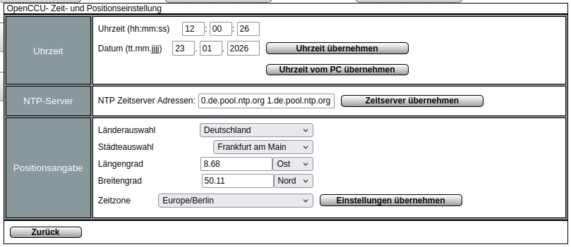
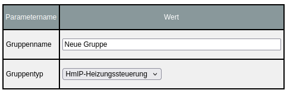
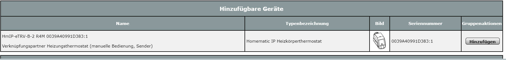
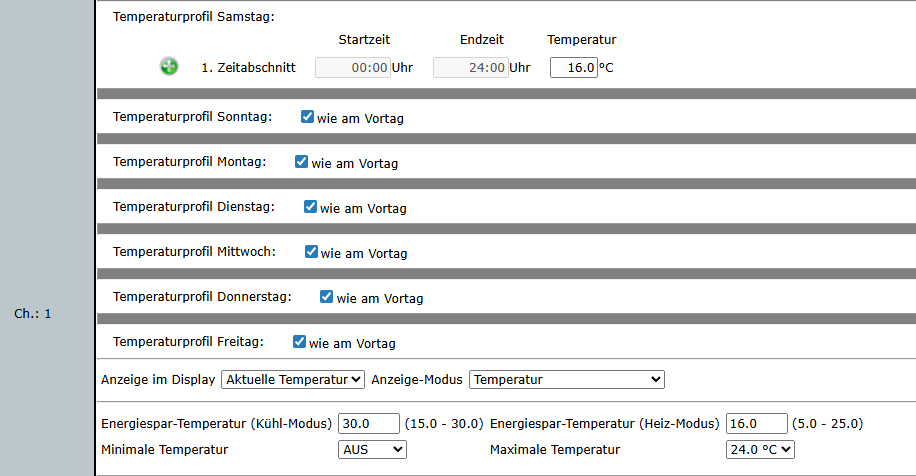
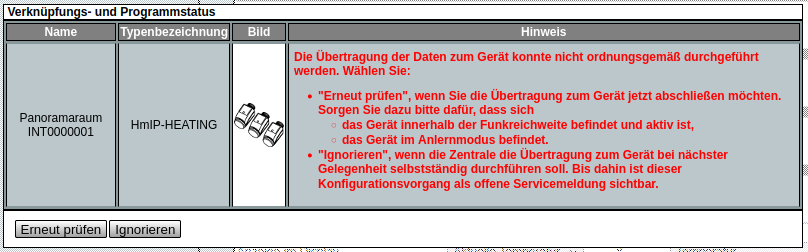

# Einrichten der CCU

## Homematic

Die Homematic-Produkte zeichnen sich durch sehr verständlich
geschriebene, deutschsprachige Installations- und Bedienungsanleitungen
aus, die vollständig auf der [Homepage](https://homematic-ip.com/) zu
finden sind.

Hier zum Beispiel:

-   [Smart Home Zentrale
    CCU3](https://homematic-ip.com/de/produkt/smart-home-zentrale-ccu3)
    -- [Technische Daten und
    Downloads](https://homematic-ip.com/de/produkt/smart-home-zentrale-ccu3#technical-data)

-   [Heizkörperthermostat --
    basic](https://homematic-ip.com/de/produkt/heizkoerperthermostat-basic)
    -- [Technische Daten und
    Downloads](https://homematic-ip.com/de/produkt/heizkoerperthermostat-basic#technical-data)

Gleiches gilt für die z.B. von ELV vertriebenen Geräte und Bausätze, zum
Beispiel:

-   [Bausatz Smart Home Funk-Modulplatine für Raspberry Pi 3 B,
    RPI-RF-MOD](https://de.elv.com/p/elv-bausatz-smart-home-funk-modulplatine-fuer-raspberry-pi-3-b-rpi-rf-mod-P152941/?itemId=152941)

Auch das verwendete Betriebssystem CCU ist ausführlich und
verständlich dokumentiert:

-   <https://github.com/OpenCCU/OpenCCU/wiki>

Es empfiehlt sich folgende Reihenfolge bei der Montage der eventuellen
Bausätze und Aktoren und der Installation:

1)  Ggf. Zusammenbau der Bausätze gemäß mitgelieferter Anleitungen

2)  Installation des Betriebssystems CCU entsprechend der
    [Anleitungen](https://github.com/OpenCCU/OpenCCU/wiki/Installation):

    -   z.B. für [Smart Home Zentrale
        CCU3](https://github.com/OpenCCU/OpenCCU/wiki/Installation-CCU3)

    -   z.B. für
        [RaspberryPi](https://github.com/OpenCCU/OpenCCU/wiki/Installation-RaspberryPi)

3)  Inbetriebnahme der CCU und Anlernen der Aktoren
    (Heizkörper-/Wandthermostate) an die CCU entsprechend der
    mitgelieferten Anleitung. Dies kann problemlos „am heimischen
    Schreibtisch" vor der Montage vor Ort im Gemeindehaus erfolgen.

4)  Montage der CCU und der Aktoren am vorgesehenen Einsatzort.

## Inbetriebnahme und Einrichtung der CCU

Die Inbetriebnahme der CCU (gleichgültig, um welche Hardware es sich
handelt) muss nicht im Gemeindehaus erfolgen, es empfiehlt sich sogar,
das einschließlich des Anlernens der Aktoren und der folgenden
Installation aller Skripte in Ruhe zu Hause zu erledigen und erst
anschließend alles im Gemeindehaus zu montieren.

Als erstes sollte die frische CCU3 ausgepackt und nach Anleitung in
Betrieb genommen werden, die Kurzanleitung genügt hierfür. Das
[Handbuch](https://homematic-ip.com/sites/default/files/downloads/homematic-ip-anwenderhandbuch.pdf)
braucht man nicht vollständig zu lesen, aber es lohnt, sich mit der
grundlegenden Oberfläche vertraut zu machen.

Um eine Protokollierung zu ermöglichen und weitere Funktionen nutzen zu
können, sollte ein FAT32 formatierter USB-Stick in die CCU eingesteckt
werden. Protokolle des Heizkalenders werden in der Grundeinstellung 10
Tage/10 Wochen gespeichert, dann werden die ältesten gelöscht. Im
Extremfall fallen 1MB je Tag an. Zusätzlich kann man mit dem USB-Stick
auch Diagramme anlegen lassen, die es erlauben, den Temperaturverlauf
der Räume zu protokollieren. Damit kann man z.B. erkennen ob die
Vorheizzeiten zu kurz oder zu lang sind.

### Systemupdate und Anlegen von Benutzern

Unmittelbar nach Erstinbetriebnahme sollte das neueste CCU3-Update
installiert werden:

Öffnen Sie in der CCU **Einstellungen → Systemsteuerung → Zentralen
Wartung** und klicken dort auf den Schalter **Automatisches Update
durchführen**. Das Update erfolgt mit mehreren Eingabeaufforderungen, es
wird die aktuelle Firmware heruntergeladen, ein Backup erstellt (das auf
dem lokalen Computer gespeichert wird) und erst dann wird die
Neuinstallation der Firmware, verbunden mit einem Systemneustart
durchgeführt.

Sofern eingerichtet oder gewünscht notieren Sie z.B. auf dem
Datenblatt den System-Sicherheitsschlüssel, den
Sie für ein Zurückspielen des Backups benötigen.

Abhängig von der vorgesehen Bedienung sollten aus Sicherheitsgründen
ggf. mehrere Benutzeraccounts für die CCU angelegt werden unter
**Einstellungen → Systemsteuerung → Benutzerverwaltung**. Das bei der
Erstinbetriebnahme eingegebene Admin-Passwort sollte sicher, aber an
einem mehreren Menschen bekannten Ort für Notfälle (z.B. Ausfall des
Hauptadministrators) verwahrt werden. Für die „normale Administration"
sollte der Hauptadministrator „sein" eigenes, persönliches Benutzerkonto
erhalten. Sofern weitere Personen die CCU bedienen sollen, sollten auch
für diese persönliche Konten eingerichtet werden.

### Eingabe von Geokoordinaten und Kontrolle der Uhrzeit

Um später über eine korrekte Temperaturermittlung über OpenMeteo zu
verfügen, müssen Sie noch die Geokoordinaten des Standortes der Gemeinde
eintragen:

Öffnen Sie in der CCU **Einstellungen →
Systemsteuerung → Zeit-/ Positionseinstellung**.

Wählen Sie entweder im Dropdown-Menü eine möglichst nahegelegene Stadt
oder ermitteln Sie über einen Onlinekartendienst (z.B.
[https://www.openstreetmap.org](https://www.openstreetmap.org/)) die
Position Ihres Gemeindehauses. Hinweis: Üblicherweise erfolgt in Karten
die Angabe des Breitengrades vor der des Längengrades --
CCU macht das umgekehrt, was bei Verwechslung ihre Gemeinde in den
Indischen Ozean verlegt und natürlich zu absurden Temperaturangaben
führen wird!

### Aktorengruppen/Heitgruppen anlegen

In der Planung haben Sie die Aktoren jedes Raumes in jeweils einer
Aktorengruppe zusammengefasst. Diese Aktorengruppen legen Sie nun in
OpenCCU an:

1)  Öffnen Sie in der CCU **Einstellungen → Gruppen** und klicken Sie
    unten auf den Schalter **Neu**. 
    
2)  Geben Sie als Gruppennamen die jeweils
    den Namen einer Aktorengruppe gemäß Ihrer Planung ein, lassen Sie
    den Gruppentyp auf „HmIP-Heizungssteuerung" und bestätigen Sie unten
    mit dem Schalter **OK**. Sofern Sie Nicht-IP-Aktoren nutzen, ändern Sie
    den Gruppentyp auf „Heizungssteuerung".

3)  Legen Sie so für jeden Raum eine Aktorengruppe an. Selbst wenn ein
    Raum nur ein einzelnes Thermostat enthält, erleichtert das die
    Steuerung durch einheitliche Struktur (es wird grundsätzlich der
    Raum angesprochen, nicht die einzelnen Thermostate) und eventuelle
    spätere Anpassungen (wenn zum Beispiel zur besseren Steuerung doch
    ein Raumthermostat hinzugefügt werden soll).\
    Für die Gemeinde Musterstadt werden also die (Aktoren-)Gruppen
    „Saal", „Gruppenraum", „Flur", „WC_D" und „WC_H" angelegt.

### Fernzugriff auf die CCU

Sofern aus der Ferne (von zu Hause) auf die CCU zugegriffen werden soll,
was für Kontroll- und Wartungszwecke sehr anzuraten ist, bestehen
mehrere Möglichkeiten:

-   Über die (gebührenpflichtige) integrierte CloudMatic:\
    **Einstellungen → Systemsteuerung → CloudMatic**

-   Über einen VPN-Tunnel zum Internetanschluss der Gemeinde, z.B. über
    eine Fritz!Box.

\[Einzelheiten hierzu werden ggf. zu einem späteren Zeitpunkt ergänzt.\]

## Anlernen der Aktoren

Das Anlernen der Aktoren ist in den beiliegenden
[Bedienungsanleitungen](https://homematic-ip.com/de/downloads) gut
beschrieben, erfolgt aber erfahrungsgemäß am zweckmäßigsten und
schnellsten in einer Art Fließbandarbeit:

1)  Alle neuen Aktoren auspacken, dabei:

    -   Den jeweils beiliegenden QR-Code auf eine Liste aufkleben und
        dazu die geplante Verwendung und die bei der [Planung](planung.md)
        festgelegte eindeutige Bezeichnung notieren.\
        Homematic stellt hierfür ein
        [Formblatt](https://homematic-ip.com/sites/default/files/downloads/hmip_qr-code-aufkleber_uebersicht_web.pdf)
        zum Download bereit.

    -   Den ausgepackten Aktor ebenfalls mit der eindeutigen Bezeichnung
        oder einer auf Formblatt und Gerät identischen (fortlaufenden)
        Nummer kennzeichnen. Das geht mit Bleistift, einem wasserfesten
        Marker o.ä. entweder im Deckel (den dann aber nicht mehr vom
        Gerät getrennt weglegen!) auf der Rückseite oder wo es denn
        passt.

2)  Nun den Trennstreifen aus dem Batteriefach ziehen. Der Aktor geht in
    den Selbsttest und anschließend automatisch für drei Minuten in den
    Anlernmodus (kurzes oranges Blinken der Systemtaste alle 10
    Sekunden). Dann in CCU oben rechts auf den Schalter **Geräte
    anlernen** und im sich öffnenden Fenster auf **HM IP Gerät anlernen**
    klicken, der Timer läuft für 60 Sekunden. Sobald das Anlernen Erfolg
    hatte (1x langes grünes Leuchten der Systemtaste des Thermostats)
    zählt die Ziffer auf dem Schalter **Posteingang** der CCU um eins hoch.

    -   Der Abstand zwischen CCU/Antenne und Aktor sollte beim Anlernen
        *mehr als 50cm* betragen, da es sonst zu
        Kommunikationsproblemen kommen kann.

    -   Klappte das Anlernen nicht beim ersten Mal, wiederholen Sie den
        Anlernvorgang durch Druck auf die Systemtaste des Thermostats
        für gut 5 Sekunden und klicken in der CCU erneut auf „Geräte
        anlernen".

    -   Wenn Sie zu schnell sind, kann es passieren, dass der
        höchstzulässige „Duty Cycle" überschritten wird: Ein
        Homematic-System darf den Funkkanal nur bis zu einer gewissen
        Dauer pro Stunde belegen. Dies können Sie auf der Startseite
        ablesen. Hat der Duty Cycle 100% erreicht, müssen Sie eine Weile
        pausieren, bis der Wert wieder auf ein zulässiges Maß abgesunken
        ist.

3)  Wechseln Sie in den „Posteingang". Hier sehen Sie die Auflistung der
    angelernten Aktoren. Klicken Sie auf die Namen der Aktoren, gleichen
    die Seriennummer mit Ihrer QR-Code-Liste und der [Planung](planung.md)
    ab und benennen sie entsprechend. Anlernen und (Um-)Benennen können
    Sie im Wechsel und dann den Aktor durch Klick auf den Button
    „Fertig" in der letzten Spalte aus dem Posteingang entfernen.\
    Lernen Sie zunächst nur die für einen Raum vorgesehenen Aktoren an
    und fahren Sie mit den folgenden Schritten fort, um die Zuweisung zu
    den Aktorengruppen zu erleichtern. Erst, wenn Sie einen Raum fertig
    (angelernt, benannt, gruppiert und die Grundprogrammierung
    angepasst) haben, fahren sie mit dem Anlernen der Aktoren des
    nächsten Raumes fort.

### Zuordnen der Aktoren zu den Aktorengruppen

Da in der Gruppenliste die Gerätenamen nicht angezeigt werden, sondern
nur die Seriennummern, ist es hilfreich, zunächst nur Aktoren eines
Raumes anzulernen, dann diese ihrer Aktorengruppe zuzuweisen, die
Grundprogrammierung anzupassen und erst anschließend die Aktoren des
nächsten Raumes anzulernen.

1)  Öffnen Sie in der CCU **Einstellungen → Gruppen**, wählen sie die
    Zeile der Gruppe aus, deren Aktoren sie gerade angelernt haben und
    klicken Sie in der letzten Spalte auf „Bearbeiten". 
2)  Suchen Sie in der Tabelle
    „Hinzufügbare Geräte" mit Hilfe Ihrer QR-Code-Liste anhand der
    Seriennummern die zu diesem Raum (also dieser Aktorengruppe)
    gehörenden Aktoren und nehmen Sie durch Klick auf den Button
    „Hinzufügen" in die Gruppe auf.

### Anpassung der Grundprogrammierung

Alle Thermostate und Gruppen haben eine Grundprogrammierung. Da man an
jedem Thermostat manuell die Temperatur einstellen kann und auch von
manueller Steuerung auf automatische Steuerung umgestellt werden kann,
muss man diese Grundprogrammierung anpassen, um unerwünschte Effekte zu
vermeiden:

-   Wer zuerst einschaltet, gewinnt.\
    Gibt es im Aktor ein Programm, das die Heizung einschaltet, wird
    beim zweiten Schalten durch das Skript höchstens die Temperatur
    nachgeregelt werden.

-   Wer zuerst ausschaltet, gewinnt.\
    Läuft die Heizung durch einen Vorgang (manuell oder Skript), wird
    die Heizung evtl. durch ein Programm des Aktors ausgeschaltet. Das
    Ausschalten durch das Skript wäre obsolet.

-   Man kann die Steuerung/Bedienbarkeit am Thermostat zwar abstellen,
    aber man möchte ja noch ein manuelles Anschalten/Abschalten
    erlauben. Also verbietet sich das Abschalten der Bedienbarkeit im
    Regelfall.

Öffnen Sie in der CCU **Einstellungen → Gruppen** und klicken auf den
Schalter **Einstellen**. Im sich öffnenden Fenster können für jeden Kanal
des Aktors die für diesen möglichen Voreinstellungen und
Programmierungen vorgenommen werden. Um die angesprochenen unerwünschten
Effekte zu vermeiden, nehmen Sie folgende Einstellungen vor:

1)  Temperaturprofil Samstag 00:00 bis 24:00 Uhr 16.0 °C\
    (oder die von Ihnen für Ihr Gebäude festgelegte Minimaltemperatur).

2)  Temperaturprofile Sonntag bis Freitag: „wie Vortag" (Häkchen setzen) 

3)  Maximale Temperatur: 24°C\
    (oder eine von Ihnen festgelegte Temperatur, die bei manueller
    Einstellung nicht überschritten werden soll)

4)  Beenden Sie die Eingaben mit Klick auf den Schalter **Übernehmen** oder
    „OK".

Eventuell erhalten Sie eine Fehlermeldung:

„Die Übertragung der Daten konnte nicht ordnungsgemäß durchgeführt
werden \[...\]". Diese kann unbesorgt durch Klicken auf den Schalter
**Ignorieren** abgeschlossen werden. Sie tritt auf, wenn in diesem Moment
keine Funkverbindung zum Aktor aufgenommen werden kann oder auch der
Duty Cycle überschritten ist. Anders als beim Anlernen werden nun aber
ausstehende Übertragungen gespeichert und bei nächster Gelegenheit
nachgeholt -- so lange bleiben sie als „Servicemeldung" gespeichert.

Setzen Sie nun das Gruppenweise Anlernen, Zuordnen und Anpassen der
Grundprogrammierung Raum für Raum und damit Aktorengruppe für
Aktorengruppe fort, bis Sie alle Geräte in der CCU angelegt und die
Grundeinstellungen vorgenommen haben.

Fahren Sie dann mit dem folgenden Kapitel „Systemvariablen einrichten"
fort und beginnen somit mit der eigentlichen Installation des
Heizkalenders.

## Weiter geht es

- Zuvor Zugangsdaten des Kalenders beschaffen: [Kalender-Zugangsdaten ermitteln](kalender-einrichten.md)
- Danach die eigentliche Einrichtung über die [`HeizkalenderInstallation.exe`](../heizkalender-installation/readme.md).
