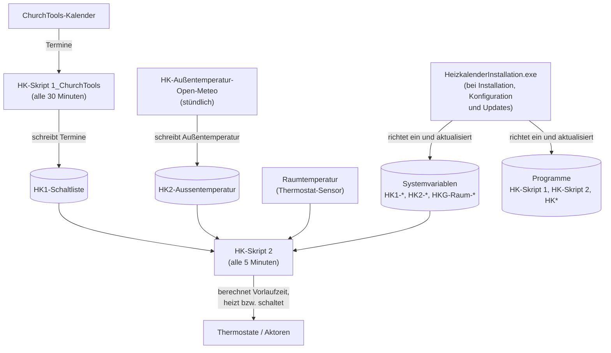

# Homematic Heizungskalender

Der HomeMatic-Heizungskalender dient zur Steuerung der HomeMatic über ChurchTool, ChurchDesk, iCal oder Google. Er steuert die Thermostate passend zur Raumnutzung.
Er bietet raumbezogene Vorheizzeiten, einen Windows-Installer, ein CCU-Add-on sowie eine Dokumentation und Werkzeuge. Er ist ideal für unregelmäßig genutzte Räume.

## Allgemeines

Der Heizkalender ist eine Idee von Helmut W. Diedrichs und wurde erstmals 2019 in der
Stadtmission Arheilgen angewendet. Lukas Helduser entwickelte 2023 auf der Basis der Homematic
das Heizkalender-Programm für die Allgemeinheit, inkl. Varianten.
Dank an die seitherigen Anwender für ihre Verbesserungsvorschläge, insbesondere an die Pilot-Gemeinden. Dieser Code wurde im Rahmen der Heizkalender-Implementierung der Baptisten Gemeinde
Hanau von Martin Richter stark optimiert und erweitert.

Das Heizkalender-Team freut sich, dass Sie den kostenlosen Heizkalender anwenden und somit einen
Beitrag zum Umweltschutz leisten. Es wäre schön, wenn Sie die Nutzung per E-Mail anzeigen an: <info@heizkalender.de>

Weitere Informationen, Varianten (neben Homematic auch Home Assistant und FRITZ!Box),
Anleitungen und ein Blog finden sich auf der Projekt-Homepage: [heizkalender.de](https://heizkalender.de/)

## Komponenten

| Komponente | Beschreibung |
| :--- | :--- |
| **Skripte** | Kern-Skripte die auf der CCU laufen: Termineinlesen (Skript 1), Schalten (Skript 2) und Hilfsskripte |
| **Heizkalender-Installation** | Windows-Programm zur Ersteinrichtung und zum Update der Skripte und Systemvariablen auf der CCU |
| **Addon** | CCU-Weboberfläche zur Anzeige von Räumen, Protokollen und Heizkurvenkontrolle |
| **Tools** | Optionale Zusatzskripte für Diagnose, Logging und Wartung |

## Zusammenspiel der Komponenten (Beispiel ChurchTools)

Die `HeizkalenderInstallation.exe` richtet die Programme (Skripte) und Systemvariablen auf der CCU ein
und hält sie bei Konfigurationsänderungen oder Updates aktuell. Die Skripte laufen danach unabhängig
voneinander in ihren eigenen Intervallen und kommunizieren ausschließlich über Systemvariablen.

Ablauf im Detail:

1. **Bei Installation/Konfiguration/Updates:** Die `HeizkalenderInstallation.exe` richtet die Programme (HK-Skript 1, HK-Skript 2 und weitere HK-Skripte) sowie die Systemvariablen auf der CCU ein und hält sie aktuell.
2. **Stündlich:** `HK-Außentemperatur-Open-Meteo` aktualisiert die Außentemperatur in `HK2-Aussentemperatur`.
3. **Alle 30 Minuten:** `HK-Skript 1_ChurchTools` liest die ChurchTools-Termine und schreibt sie in `HK1-Schaltliste`.
4. **Alle 5 Minuten:** `HK-Skript 2` berechnet aus der Schaltliste, der Außentemperatur, den Systemvariablen und der aktuellen Raumtemperatur die Vorlaufzeiten und heizt bzw. schaltet die Räume entsprechend.

## Einstieg

- Neu hier? Starte mit dem [Anwenderhandbuch](heizkalender/anwenderhandbuch.md)
- Einrichtung der CCU: [CCU einrichten](heizkalender/ccu-einrichten.md)
- Kalender verbinden: [Kalender einrichten](heizkalender/kalender-einrichten.md)
- Installationsprogramm: [Heizkalender-Installation](heizkalender-installation/readme.md)
